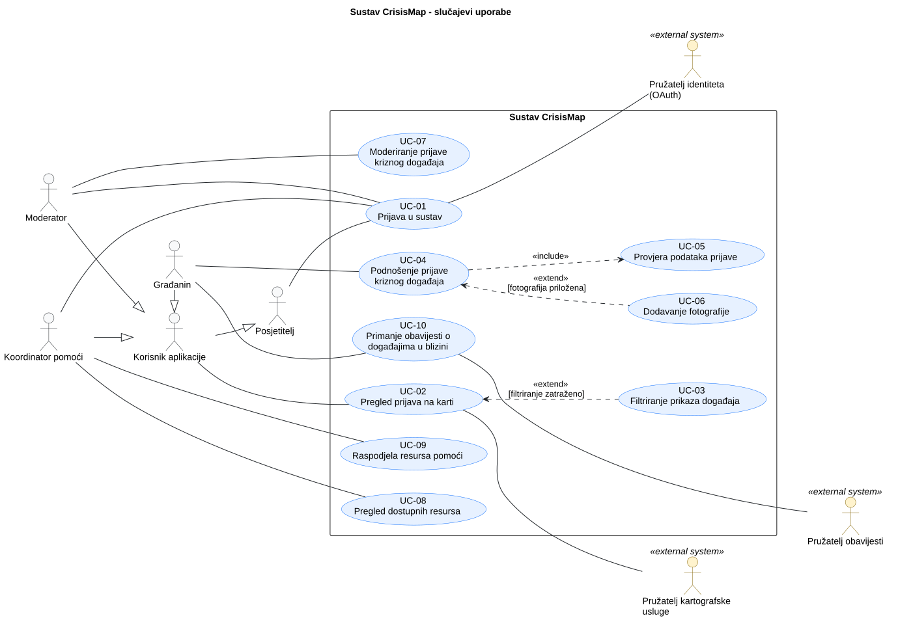

# 3. Obrasci uporabe

**Cilj:** Prikazati glavne interakcije između aktera aplikacije i sustava. Opišite kako akter ostvaruje cilj i što se događa kada važan korak ne uspije. Interakcije temeljite na odobrenim zahtjevima i ažurirajte ih kako se aplikacija razvija.

## 3.1 Dijagram obrazaca uporabe

**Cilj:** Prikazati granicu sustava, relevantne aktere i njihove glavne ciljeve u **preglednom UML dijagramu obrazaca uporabe**. Ako je za razumijevanje pojedinog dijela sustava potrebno prikazati više detalja, taj dio izdvojite u dodatni usmjereni dijagram. Dodatni dijagrami trebaju produbiti dio preglednog modela, a ne stvarati nepovezane ili duplicirane prikaze istog sustava.

**Slika 3.1. Dijagram obrazaca uporabe sustava CrisisMap**

**PlantUML izvor:** [izvor](./puml/3-1-crisismap-system-UC.puml)

**Provjera dijagrama:** Prikažite prepoznate uloge koje **komuniciraju s aplikacijom**, a ne dionike koji s njom nemaju interakciju. Svaki glavni korisnički cilj mora imati pridruženog aktera; uključeni obrazac uporabe može se dosegnuti preko drugog obrasca uporabe bez vlastite izravne veze s akterom. `<<include>>` i `<<extend>>` koristite samo kada odnos odgovara stvarnom ponašanju.

<strong>Primjer aktera i granica sustava</strong>

**Opis primjera — CrisisMap:**

Dijagram prikazuje **ogledni scenarij** s građaninom, posjetiteljem i koordinatorom pomoći te vanjskim pružateljem identiteta. Pružatelj identiteta sudjeluje u obrascu uporabe „Prijava u sustav” kao sekundarni akter: korisnik pokreće prijavu u aplikaciji, a vanjski sustav provodi autentikaciju. Budući da projekt koristi vanjskog pružatelja identiteta, ta se ovisnost prikazuje i u dijagramu obrazaca uporabe; tehnički detalji integracije pripadaju arhitekturnoj dokumentaciji.

**Odabir aktera i ciljeva:** Granica pokazuje što aplikacija nudi, akteri imaju različite ciljeve, a nijedan akter ni obrazac uporabe ne tvrdi da ova studentska aplikacija angažira hitne službe. Dijagram usporedite s odobrenim funkcijskim zahtjevima i akterima.

**Pet pitanja za odabir sadržaja dijagrama** (ne pet dijagrama za predaju):

| Fokus                   | Pitanje                                                                                                                     |
| ----------------------- | --------------------------------------------------------------------------------------------------------------------------- |
| Cijeli sustav           | Koji korisnički ciljevi najbolje objašnjavaju čemu ova aplikacija služi?                                                    |
| Ključne funkcionalnosti | Koje ciljeve treba detaljnije opisati ili, ako je potrebno, prikazati zasebnim usmjerenim dijagramom?                       |
| Korisničke uloge        | Koji akteri mogu sudjelovati u pojedinom cilju i kako se njihove ovlasti razlikuju?                                         |
| Ključni procesi         | Koji cilj ima važne alternative koje treba opisati u obrascu uporabe?                                                       |
| Vanjske integracije     | Sudjeluje li drugi sustav u obrascu uporabe kao **sekundarni akter**, primjerice odobreni pružatelj identiteta pri prijavi? |

Vanjski sustav može biti sekundarni akter obrasca uporabe kada sudjeluje u ostvarenju korisničkog cilja; tehničke veze opisuju se u arhitekturi. Nemojte stvarati dodatni obavezni dijagram obrazaca uporabe samo radi popisa integracija. Prenatrpan dijagram podijelite prema povezanim akterima ili ciljevima samo kada time postaje čitljiviji.

## 3.2 Specifikacije obrazaca uporabe

**Cilj:** Za svaki obrazac uporabe iz dijagrama objasniti cilj aktera, uobičajenu interakciju s aplikacijom i važne alternative. Jednostavne obrasce uporabe opišite kratko; proširite one kod kojih alternative, vanjske ovisnosti ili posljedice zahtijevaju dodatno objašnjenje.

**Za svaki obrazac uporabe koristite jednu okomitu tablicu.** Navedite samo onoliko pojedinosti koliko interakcija zahtijeva; neprimjenjivu alternativu izostavite umjesto da je popunjavate samo radi forme.

### UC-[ID]: [Naziv usmjeren na cilj]

| Element specifikacije             | Opis                                                                                                                                      |
| :-------------------------------- | :---------------------------------------------------------------------------------------------------------------------------------------- |
| **Primarni akter**                | [Uloga definirana u analizi zahtjeva]                                                                                                     |
| **Povezani zahtjevi**             | [Identifikatori funkcijskih zahtjeva, npr. F-001, F-004]                                                                                  |
| **Preduvjeti**                    | [Stanje sustava koje mora biti zadovoljeno prije početka izvođenja]                                                                       |
| **Glavni uspješni tok**           | 1. Akter pokreće akciju. 2. Program obrađuje unos i vraća povratnu informaciju. 3. [Koračni prikaz interakcije do ostvarenja cilja] |
| **Alternativni tokovi / Iznimke** | **[Korak]a — [Naziv iznimke]:** [Uvjet nastanka, reakcija programa i nastavak toka]                                                       |
| **Posljedice (ishod)**            | [Promjena stanja podataka ili potvrda nakon uspješnog završetka]                                                                          |

<strong>Primjeri specifikacija: Registracija i prijava kriznog događaja</strong>

**Primjer — CrisisMap:**

**UC-001: Registracija računa.** Ovaj kratki primjer odnosi se na projekt čiji odobreni zadatak uključuje račune s adresom e-pošte i lozinkom.

| Polje                                             | Opis                                                                                            |
| ------------------------------------------------- | ----------------------------------------------------------------------------------------------- |
| Primarni akter                                    | Građanin (A-02 u primjeru)                                                                      |
| ID zahtjeva                                       | F-001                                                                                           |
| Preduvjeti, ako postoje                           | Nema.                                                                                           |
| Glavni tijek                                      | Građanin unosi adresu e-pošte; aplikacija šalje poveznicu za potvrdu; građanin potvrđuje račun. |
| Alternativni ili neuspješni tijekovi, ako postoje | Adresa e-pošte već postoji → aplikacija objašnjava zašto se registracija ne može nastaviti.     |
| Rezultat                                          | Račun je aktivan nakon potvrde.                                                                 |

Ako odobreni zadatak umjesto toga koristi isključivo OAuth prijavu, zamijenite ovaj primjer odgovarajućim ponašanjem prijave; nemojte dodavati registraciju lokalnom lozinkom samo radi podudaranja s primjerom.

**UC-002: Podnošenje prijave kriznog događaja.** Ista polja mogu opisati dulji tijek u kojem odabir lokacije, provjera valjanosti i pohrana mogu ne uspjeti.

| Polje                                             | Opis                                                                                                                                                                                                                                                                                                                                                                                                                                                                                                                                                                                                                                                                                                 |
| ------------------------------------------------- | ---------------------------------------------------------------------------------------------------------------------------------------------------------------------------------------------------------------------------------------------------------------------------------------------------------------------------------------------------------------------------------------------------------------------------------------------------------------------------------------------------------------------------------------------------------------------------------------------------------------------------------------------------------------------------------------------------- |
| Primarni akter                                    | Građanin                                                                                                                                                                                                                                                                                                                                                                                                                                                                                                                                                                                                                                                                                             |
| ID zahtjeva                                       | F-004                                                                                                                                                                                                                                                                                                                                                                                                                                                                                                                                                                                                                                                                                                |
| Preduvjeti, ako postoje                           | Obrazac za prijavu dostupan je. Ako odobreni zadatak zahtijeva prijavu u sustav, građanin je prijavljen.                                                                                                                                                                                                                                                                                                                                                                                                                                                                                                                                                                                             |
| Glavni tijek                                      | 1. Građanin otvara obrazac za prijavu; aplikacija prikazuje polja za vrstu kriznog događaja, razinu ozbiljnosti, opis i lokaciju. 2. Građanin unosi podatke i odabire lokaciju na karti ili drugim podržanim načinom. 3. Građanin podnosi obrazac; aplikacija provjerava obavezna polja i lokaciju. 4. Aplikacija pohranjuje prijavu i prikazuje potvrdu s referencom na nju.                                                                                                                                                                                                                                                                                                               |
| Alternativni ili neuspješni tijekovi, ako postoje | **1a — Prijava u sustav nije uspjela:** Ako je prijava obavezna, a pružatelj identiteta je ne dovrši, prijava kriznog događaja ostaje nepodnesena i aplikacija objašnjava kako pokušati ponovno. **2a — Odbijen pristup lokaciji:** Ako aplikacija nudi geolokaciju, ali je korisnik odbije, građanin ručno odabire lokaciju ako ta mogućnost postoji; tijek se nastavlja u koraku 3. **3a — Nevaljana ili nedostajuća lokacija:** Aplikacija objašnjava problem, po mogućnosti zadržava unesene podatke i ne pohranjuje prijavu; građanin ispravlja lokaciju i ponavlja korak 3. **3b — Pohrana nije uspjela:** Aplikacija prijavljuje neuspjeh i ne prikazuje lažnu potvrdu o podnošenju. |
| Rezultat                                          | Aplikacija pohranjuje prijavu kriznog događaja i potvrđuje njezino podnošenje.                                                                                                                                                                                                                                                                                                                                                                                                                                                                                                                                                                                                                       |

**Odabir razine detalja:** Oba primjera koriste ista polja. UC-001 je kratak jer je glavna iznimka jasna; UC-002 zahtijeva numerirane korake i alternative jer oni mijenjaju ishod i mogu usmjeravati ispitivanje.Pri prilagodbi primjera koristite ID-ove zahtjeva i ponašanje vlastite aplikacije.

**UC-005: Moderiranje prijave kriznog događaja.** Ovaj primjer vrijedi samo za projekt u kojem odobreni opseg uključuje moderatorski pregled prijava.

| Polje                                             | Opis                                                                                                                                                                                                                                                              |
| ------------------------------------------------- | ----------------------------------------------------------------------------------------------------------------------------------------------------------------------------------------------------------------------------------------------------------------- |
| Primarni akter                                    | Moderator (A-05 u primjeru)                                                                                                                                                                                                                                       |
| ID zahtjeva                                       | F-008                                                                                                                                                                                                                                                             |
| Preduvjeti, ako postoje                           | Moderator je prijavljen i ima moderatorske ovlasti; postoji prijava koja čeka pregled.                                                                                                                                                                            |
| Glavni tijek                                      | 1. Moderator otvara prijavu koja čeka pregled. 2. Aplikacija prikazuje podatke prijave i dostupne moderatorske radnje. 3. Moderator odabire odobravanje ili odbijanje. 4. Aplikacija provjerava ovlasti, mijenja status prijave i prikazuje novi status. |
| Alternativni ili neuspješni tijekovi, ako postoje | **3a — Radnja nije potvrđena:** Moderator odustaje od promjene i prijava ostaje nepromijenjena. **4a — Ovlasti nisu valjane:** Aplikacija odbija promjenu i status prijave ostaje nepromijenjen.                                                               |
| Rezultat                                          | Prijava ima novi status ako je moderatorska radnja uspješno provedena; inače ostaje nepromijenjena.                                                                                                                                                               |

---

### UC-1.1: Prijava studenta Microsoft računom

| Element specifikacije             | Opis |
| :-------------------------------- | :--- |
| **Primarni akter**                | A-02 Student (uz A-05 Microsoft Entra ID) |
| **Povezani zahtjevi**             | F-001, F-002, F-032 |
| **Preduvjeti**                    | Korisnik nije prijavljen i ima studentski Microsoft račun. |
| **Glavni uspješni tok**           | 1. Student otvara stranicu `/prijava` (ili na stranici ponude odabire „Prijavi se za kupon”). 2. Student odabire „Prijava Microsoft računom”. 3. Microsoft Entra ID potvrđuje identitet i vraća studenta u aplikaciju (`/auth/callback`). 4. Sustav provjerava da je domena e-mail adrese na popisu hrvatskih visokih učilišta. 5. Pri prvoj prijavi sustav stvara profil s ulogom „student”, statusom „potvrđen” i nazivom učilišta. 6. Sustav vodi studenta na `/dobrodoslica` (UC-1.3), a zatim na stranicu s koje je krenuo. |
| **Alternativni tokovi / Iznimke** | **3a — Student odustane ili prijava kod Microsofta ne uspije:** sustav vraća studenta na `/prijava` s porukom „Prijava nije uspjela. Pokušaj ponovno.” **4a — Domena nije na popisu:** sustav odjavljuje korisnika i prikazuje poruku da je prijava Microsoft računom dostupna samo studentima hrvatskih visokih učilišta. **5a — Račun je deaktiviran (F-026, UC-1.4):** sustav odjavljuje korisnika i prikazuje poruku da je račun deaktiviran. **6a — Uvjeti su već prihvaćeni:** `/dobrodoslica` odmah šalje studenta dalje. **6b — Odredišna adresa je vanjska:** sustav umjesto nje vodi na naslovnicu. |
| **Posljedice (ishod)**            | Student je prijavljen, a profil ima potvrđen status studenta i naziv učilišta; student smije generirati kupone (UC-5.1). |

### UC-1.2: Prijava partnera Google računom ili e-mailom

| Element specifikacije             | Opis |
| :-------------------------------- | :--- |
| **Primarni akter**                | A-03 Partner (uz A-05 Google i A-08 Resend) |
| **Povezani zahtjevi**             | F-001, F-002, F-032 |
| **Preduvjeti**                    | Korisnik nije prijavljen. |
| **Glavni uspješni tok**           | 1. Partner otvara stranicu `/prijava`. 2. Partner odabire prijavu Google računom, a Google potvrđuje identitet. 3. Pri prvoj prijavi sustav stvara profil s ulogom „partner”. 4. Sustav vodi partnera na `/dobrodoslica` (UC-1.3), a zatim na odredišnu stranicu; na partnerskoj ploči `/partner` partner zatim registrira poslovni subjekt (F-006). |
| **Alternativni tokovi / Iznimke** | **2a — Prijava e-mailom i lozinkom, račun ne postoji:** sustav stvara račun, šalje e-mail s poveznicom za potvrdu adrese i prikazuje poruku o tome; partner se prijavljuje nakon potvrde. **2b — Adresa još nije potvrđena:** sustav prikazuje poruku da treba kliknuti poveznicu iz e-maila. **2c — Pogrešna lozinka za postojeći račun:** sustav prikazuje poruku o pogrešnoj lozinci i upućuje na prijavu Googleom ako je račun stvoren tako. **2d — Poveznica za potvrdu otvorena u drugom pregledniku:** adresa je potvrđena, a sustav prikazuje poruku da se partner sada može prijaviti. **2e — Lozinka kraća od 6 znakova pri registraciji:** sustav prikazuje poruku da registracija nije uspjela. **3a — Račun je deaktiviran:** sustav odjavljuje korisnika i prikazuje poruku da je račun deaktiviran. |
| **Posljedice (ishod)**            | Partner je prijavljen s ulogom „partner”; ne može generirati kupone (F-004). |

### UC-1.3: Prihvaćanje uvjeta korištenja pri prvoj prijavi

| Element specifikacije             | Opis |
| :-------------------------------- | :--- |
| **Primarni akter**                | A-02 Student ili A-03 Partner |
| **Povezani zahtjevi**             | F-032, F-002 |
| **Preduvjeti**                    | Korisnik se upravo prvi put prijavio (UC-1.1 ili UC-1.2) i još nije prihvatio uvjete korištenja. |
| **Glavni uspješni tok**           | 1. Sustav prikazuje stranicu `/dobrodoslica` s poljem za ime i prezime (ispunjenim podatkom pružatelja identiteta, ako postoji) i poveznicom na uvjete korištenja (`/uvjeti`). 2. Korisnik po potrebi ispravlja ime i označava da prihvaća uvjete korištenja, u kojima piše da student uz kupon pokazuje studentsku iskaznicu (X-icu). 3. Sustav sprema ime i vrijeme prihvaćanja uvjeta (vrijeme postavlja baza). 4. Sustav vodi korisnika na stranicu s koje je krenuo. |
| **Alternativni tokovi / Iznimke** | **2a — Uvjeti nisu označeni:** sustav prikazuje poruku „Za nastavak prihvati uvjete korištenja.” i ništa ne sprema. **2b — Ime je prazno ili dulje od 100 znakova:** sustav prikazuje poruku o duljini imena. **4a — Korisnik bez prihvaćenih uvjeta otvori drugu stranicu za prijavljene:** sustav ga vraća na `/dobrodoslica`. |
| **Posljedice (ishod)**            | Profil ima ime i vrijeme prihvaćanja uvjeta; korisnik može koristiti stranice svoje uloge. |

### UC-1.4: Uređivanje profila i deaktivacija vlastitog računa

| Element specifikacije             | Opis |
| :-------------------------------- | :--- |
| **Primarni akter**                | A-02 Student, A-03 Partner ili A-04 Administrator |
| **Povezani zahtjevi**             | F-005, NF-03 |
| **Preduvjeti**                    | Korisnik je prijavljen i prihvatio je uvjete korištenja. |
| **Glavni uspješni tok**           | 1. Korisnik otvara stranicu `/profil`. 2. Sustav prikazuje e-mail, ulogu i, za studenta, naziv učilišta. 3. Korisnik mijenja ime i prezime i sprema promjenu. 4. Sustav sprema ime i prikazuje poruku „Promjene su spremljene.” |
| **Alternativni tokovi / Iznimke** | **3a — Ime je prazno ili dulje od 100 znakova:** sustav prikazuje poruku o duljini imena i ništa ne sprema. **3b — Korisnik deaktivira račun:** korisnik označava da razumije posljedice i potvrđuje deaktivaciju; sustav označava račun kao neaktivan, odjavljuje korisnika i prikazuje poruku da je račun deaktiviran. Ponovno ga može aktivirati samo administrator (F-026). **3c — Deaktivacija bez potvrde posljedica:** sustav prikazuje poruku i račun ostaje aktivan. **3d — Pokušaj promjene uloge ili statusa studenta mimo sučelja:** baza odbija promjenu (NF-03). |
| **Posljedice (ishod)**            | Profil ima novo ime ili je račun deaktiviran; deaktivirani korisnik ne može se ponovno prijaviti, a njegove recenzije nisu javne. |

### UC-5.1: Generiranje kupona za ponudu

| Element specifikacije             | Opis                                                                                                                                                                                                                                                                                                                                                                                                                                                                                                                                                                                                                                                                                                                                                                                                                                     |
| :-------------------------------- | :--------------------------------------------------------------------------------------------------------------------------------------------------------------------------------------------------------------------------------------------------------------------------------------------------------------------------------------------------------------------------------------------------------------------------------------------------------------------------------------------------------------------------------------------------------------------------------------------------------------------------------------------------------------------------------------------------------------------------------------------------------------------------------------------------------------------------------------- |
| **Primarni akter**                | A-02 Student                                                                                                                                                                                                                                                                                                                                                                                                                                                                                                                                                                                                                                                                                                                                                                                                                             |
| **Povezani zahtjevi**             | F-020, F-021, F-004, F-032, NF-07, NF-08                                                                                                                                                                                                                                                                                                                                                                                                                                                                                                                                                                                                                                                                                                                                                                                                 |
| **Preduvjeti**                    | Student je prijavljen i ima potvrđen status studenta. Ponuda je aktivna i rok joj nije prošao.                                                                                                                                                                                                                                                                                                                                                                                                                                                                                                                                                                                                                                                                                                                                           |
| **Glavni uspješni tok**           | 1. Student otvara stranicu ponude. 2. Student odabire „Generiraj kupon”. 3. Sustav provjerava da je student potvrđen i da je ponuda aktivna. 4. Sustav generira jedinstveni kod od 10 znakova koji nije moguće pogoditi i sprema kupon sa statusom „izdan”. 5. Sustav prikazuje stranicu kupona s kodom, QR kodom, nazivom ponude i partnera, rokom važenja i napomenom da uz kupon treba pokazati studentsku iskaznicu (X-icu).                                                                                                                                                                                                                                                                                                                                                                                             |
| **Alternativni tokovi / Iznimke** | **1a — Korisnik nije prijavljen:** umjesto gumba prikazuje se poveznica „Prijavi se za kupon”; nakon prijave student se vraća na istu ponudu. **3a — Status studenta nije potvrđen:** sustav prikazuje poruku da kupon može generirati samo student s potvrđenim statusom; kupon se ne stvara (F-004). **3b — Ponuda je istekla ili nije dostupna:** sustav prikazuje poruku i kupon se ne stvara. **3c — Ponuda „jednom po studentu” je već iskorištena:** sustav prikazuje poruku o razlogu i kupon se ne stvara (F-021). **3d — Ponuda „jednom po studentu”, student već ima važeći neiskorišten kupon:** sustav ne stvara novi kupon, nego prikazuje postojeći (F-021). **4a — Generirani kod već postoji:** sustav generira novi kod, najviše tri puta; ako ne uspije, prikazuje poruku da generiranje nije uspjelo. |
| **Posljedice (ishod)**            | U bazi postoji kupon sa statusom „izdan” vezan uz studenta i ponudu. Student ga pokazuje partneru na zaslonu mobitela do isteka ponude.                                                                                                                                                                                                                                                                                                                                                                                                                                                                                                                                                                                                                                                                                                  |

### UC-5.2: Potvrda korištenja kupona

| Element specifikacije             | Opis                                                                                                                                                                                                                                                                                                                                                           |
| :-------------------------------- | :------------------------------------------------------------------------------------------------------------------------------------------------------------------------------------------------------------------------------------------------------------------------------------------------------------------------------------------------------------- |
| **Primarni akter**                | A-03 Partner                                                                                                                                                                                                                                                                                                                                                   |
| **Povezani zahtjevi**             | F-014, F-032, NF-03                                                                                                                                                                                                                                                                                                                                            |
| **Preduvjeti**                    | Partner je prijavljen i njegov profil je odobren. Student mu pokazuje kupon na mobitelu.                                                                                                                                                                                                                                                                       |
| **Glavni uspješni tok**           | 1. Partner otvara zaslon za potvrdu kupona. 2. Partner upisuje kod s kupona ili skenira QR kod. 3. Sustav pronalazi kupon i prikazuje ponudu, status i napomenu da student treba pokazati studentsku iskaznicu (X-icu). 4. Partner potvrđuje korištenje. 5. Sustav kuponu postavlja status „iskorišten” i vrijeme korištenja te prikazuje potvrdu. |
| **Alternativni tokovi / Iznimke** | **3a — Kod ne postoji:** sustav prikazuje poruku da kupon nije pronađen. **3b — Kupon je za ponudu drugog partnera:** sustav odbija potvrdu. **3c — Kupon je već iskorišten ili je istekao:** sustav prikazuje status kupona i ne dopušta potvrdu. **4a — Student ne pokaže X-icu:** partner odustaje od potvrde; kupon ostaje „izdan”.               |
| **Posljedice (ishod)**            | Kupon ima status „iskorišten” s vremenom korištenja; student za njega može ostaviti recenziju (UC-5.4).                                                                                                                                                                                                                                                        |

### UC-5.3: Pregled povijesti kupona

| Element specifikacije             | Opis                                                                                                                                                                                                                       |
| :-------------------------------- | :------------------------------------------------------------------------------------------------------------------------------------------------------------------------------------------------------------------------- |
| **Primarni akter**                | A-02 Student                                                                                                                                                                                                               |
| **Povezani zahtjevi**             | F-022                                                                                                                                                                                                                      |
| **Preduvjeti**                    | Student je prijavljen.                                                                                                                                                                                                     |
| **Glavni uspješni tok**           | 1. Student otvara svoj profil. 2. Sustav prikazuje popis svih studentovih kupona s ponudom, partnerom, datumom i statusom (izdan, iskorišten, istekao). 3. Student odabire kupon i sustav prikazuje stranicu kupona. |
| **Alternativni tokovi / Iznimke** | **2a — Student nema kupona:** sustav prikazuje poruku da još nema generiranih kupona.                                                                                                                                      |
| **Posljedice (ishod)**            | Nema promjene podataka.                                                                                                                                                                                                    |

### UC-5.4: Ocjenjivanje partnera

| Element specifikacije             | Opis                                                                                                                                                                                                     |
| :-------------------------------- | :------------------------------------------------------------------------------------------------------------------------------------------------------------------------------------------------------- |
| **Primarni akter**                | A-02 Student                                                                                                                                                                                             |
| **Povezani zahtjevi**             | F-023                                                                                                                                                                                                    |
| **Preduvjeti**                    | Student je prijavljen i ima iskorišten kupon za ponudu tog partnera.                                                                                                                                     |
| **Glavni uspješni tok**           | 1. Student u povijesti kupona odabire iskorišteni kupon i „Ocijeni”. 2. Student odabire ocjenu od 1 do 5 i po želji piše komentar. 3. Sustav sprema recenziju i ažurira prosječnu ocjenu partnera. |
| **Alternativni tokovi / Iznimke** | **1a — Kupon nije iskorišten:** mogućnost ocjenjivanja se ne prikazuje; pokušaj mimo sučelja baza odbija. **3a — Kupon je već ocijenjen:** sustav odbija drugu recenziju za isti kupon.               |
| **Posljedice (ishod)**            | Recenzija je javno vidljiva na profilu partnera; administrator je može ukloniti.                                                                                                                         |

## 3.3 Provjera dosljednosti obrazaca uporabe

**Cilj:** Provjeriti međusobnu usklađenost obrazaca uporabe, aktera, zahtjeva i ispitnih slučajeva. Cjelovito mapiranje održava se isključivo u **[matrici sljedivosti zahtjeva](2-Analiza-zahtjeva.md#26-sljedivost-zahtjeva)**.

| Provjera   | Pitanje za tim                                                                                                              |
| ---------- | --------------------------------------------------------------------------------------------------------------------------- |
| Zahtjev    | Je li svaki važan obrazac uporabe povezan s postojećim zahtjevom?                                                           |
| Akter      | Odgovara li akter naveden ovdje prethodno utvrđenoj ulozi i dopuštenoj interakciji?                                         |
| Aplikacija | Može li tim demonstrirati opisani glavni rezultat i važnu alternativu ili je opis jasno označen kao trenutačno oblikovanje? |

---

Povezivanje zahtjev → obrazac uporabe → ispitivanje održavajte **samo jednom, u [tablici sljedivosti zahtjeva](./2-Analiza-zahtjeva.md)**. Ovdje nemojte održavati drugu projektnu tablicu mapiranja ni stupac sa statusom implementacije. Ako važan zahtjev nema interakciju s ljudskim akterom, objasnite gdje se obrađuje umjesto izmišljanja aktera.

<strong>Provjera pokrivenosti zahtjeva</strong>

**Primjer — CrisisMap:** Tablica pokrivenosti obrazaca uporabe koju treba analizirati:

| Broj obrasca uporabe | Naziv obrasca uporabe    | Obuhvaćeni funkcijski zahtjevi                  |
| -------------------- | ------------------------ | ----------------------------------------------- |
| UC-001               | Registracija računa      | F-001: Registracija računa putem e-pošte        |
| UC-002               | Prijava kriznog događaja | F-022: Prijava i provjera kriznog događaja      |
| UC-003               | Sustav upozorenja        | F-045: Slanje upozorenja korisnicima i timovima |
| UC-004               | Koordinacija spašavanja  | F-067: Koordinacija s hitnim službama           |

---

**Problemi pokrivenosti koje treba riješiti:**

- **Pogrešan ID zahtjeva:** ova tablica povezuje UC-002 s F-022, dok se opis UC-002 u odjeljku 3.2 poziva na F-004, zahtjev za podnošenje prijave iz odjeljka 2.1.
- **Zahtjevi koji ne postoje:** F-022, F-045 i F-067 nisu definirani u oglednim zahtjevima u 2.1.
- **Obrasci uporabe bez opisa:** UC-003 i UC-004 nemaju opis u 3.2. UC-004 (koordinacija s hitnim službama) ujedno je mogućnost s vanjskim posljedicama koju opseg dopušta samo ako je uključena u odobreni zadatak.
- **Nesklad aktera:** primjer aktera u odjeljku 2.3 navodi da koordinator pomoći podnosi prijave (F-004), dok UC-002 kao primarnog aktera navodi građanina.

**Završna provjera:** Dijagram, specifikacije obrazaca uporabe i matrica sljedivosti međusobno su usklađeni. Svaki važan obrazac uporabe povezan je s postojećim zahtjevom, akteri odgovaraju stvarnim ulogama u aplikaciji, a opisani glavni i alternativni tijekovi odgovaraju ponašanju koje sustav stvarno podržava.
