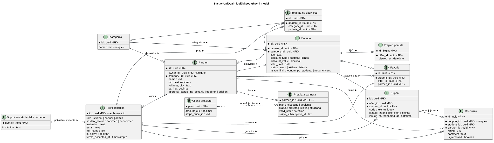
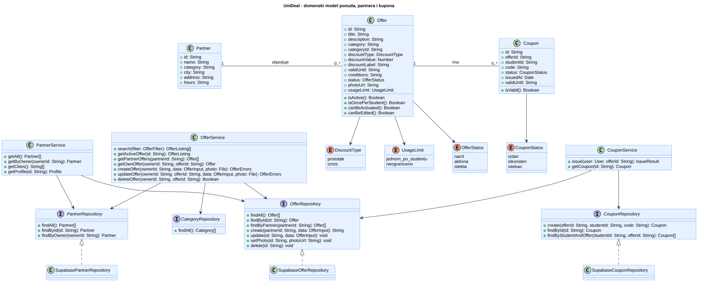

# 4. Arhitektura i oblikovanje

**Cilj:** Definirati arhitekturni stil, dekompoziciju programa na podsustave i module, organizaciju podataka te dinamičko ponašanje tijekom izvođenja. Arhitektura predstavlja temelj za implementaciju i ažurira se pri svakoj važnijoj promjeni projektnih odluka.

| Arhitekturni pogled | Ključno inženjersko pitanje | Primijenjeni model ili dijagram |
| :--- | :--- | :--- |
| **Strategija rješenja** | Koji stil i temeljne odluke određuju program? | Tablica odluka (odjeljak 4.1) |
| **Struktura podsustava** | Koji su glavni dijelovi i kako komuniciraju? | Dijagram komponenata |
| **Model podataka** | Kako su strukturirani trajni podaci programa? | Relacijski ER dijagram |
| **Struktura koda** | Kako su dodijeljene odgovornosti i ključne klase? | Reprezentativni dijagram razreda |
| **Dinamičko ponašanje** | Kako moduli surađuju pri obradi ključnih transakcija? | sekvencijski dijagram |
| **Stanja sustava** | Kako ključni domenski objekt mijenja svoja stanja? | Dijagram stanja |
| **Fizički razmještaj** | Na kojim se izvršnim čvorovima program izvodi? | Dijagram razmještaja (poglavlje 6) |

---

<!--Za svaki UML dijagram čuvajte čitljivu sliku i PlantUML izvor, kako je opisano na stranici [Home](./Home.md). U dovršenoj stranici koristite vlastite projektne odluke i modele.-->

## 4.1 Ključne arhitekturne odluke

**Cilj:** Objasniti nekoliko arhitekturnih odluka koje najviše utječu na rješenje i navesti njihove projektno specifične razloge.

| Odluka | Razmatrana alternativa | Projektno specifično obrazloženje i kompromis |
| --- | --- | --- |
| Jedna Next.js aplikacija na Vercelu: stranice i poslužiteljska logika (Server Actions) u istom projektu | Zaseban poslužiteljski REST API (npr. Node.js ili Spring) i odvojeni klijent u pregledniku | Gotovo sve radnje korisnika (registracija partnera, ponude, kuponi, administracija) su obrasci koji se šalju Server Actionima, pa ne postoji zaseban API čiji ugovor treba usklađivati između dviju aplikacija. Poslovna pravila su u slojevima `domain`, `services` i `repositories` (NF-12), neovisno o Next.js-u. Funkcije se izvode u Vercelovoj regiji `dub1`, uz bazu u Irskoj, pa je put između poslužitelja i baze kratak. **Kompromis:** aplikacija je vezana uz Next.js i Vercel i nema stalni poslužitelj za poslove u pozadini; istek ponude zato ne obrađuje zaseban posao, nego ga provjerava datum u pogledu `public_offers`. |
| Supabase (Postgres, Auth, Storage), a ovlasti provode RLS pravila u bazi uz dodatnu provjeru uloge u aplikaciji | Vlastiti poslužiteljski API koji jedini pristupa bazi i sam provjerava ovlasti | Javni ključ baze vidljiv je u pregledniku, pa korisnik sa sesijom može bazi slati zahtjeve mimo sučelja; zato ovlasti mora provoditi sama baza (NF-03). RLS određuje što student, partner i administrator smiju čitati i mijenjati, a `requireRole()` u aplikaciji daje jasne poruke i preusmjeravanja. Pravila provjerava SQL test `supabase/tests/rls.sql` (CT-1.3). **Kompromis:** pravila u SQL-u teže je čitati i ispitati nego kod aplikacije; migracije se primjenjuju ručno u SQL Editoru (6), a lokalni razvoj i produkcija dijele istu bazu, pa i probni računi pri ispitivanju nastaju u produkciji. |
| Studenti se prijavljuju studentskim Microsoft računom, a domena adrese potvrđuje status studenta (F-002) | Potvrda studentske e-mail adrese poveznicom (izvorni F-003, vidi 2.5); prijava putem AAI@EduHr | Studentske adrese hrvatskih visokih učilišta uglavnom su Microsoft računi, pa prijava ujedno dokazuje da student ima tu adresu, bez zasebne poveznice; `/auth/callback` domenu provjerava prema tablici `allowed_student_domains`. AAI@EduHr bi razlikovao studente od djelatnika, ali traži registraciju aplikacije kod ustanove ili Srca, pa je odgođen (7.3). **Kompromis:** domena ne razlikuje studenta od djelatnika iste ustanove (AS-01), pa student uz kupon pokazuje X-icu (F-032); student učilišta bez Microsoft računa ne može se prijaviti kao student. |
| Pretplata se plaća na Stripeovoj stranici (Stripe Checkout) | Vlastiti obrazac za unos kartice u aplikaciji (npr. Stripe Elements) | Podaci kartice ne prolaze kroz aplikaciju (NF-05), pa ih ona ne obrađuje ni ne pohranjuje. Stripe je iza sučelja `PaymentGateway`, pa se pravila pretplate ispituju bez Stripea, a demonstracija koristi Stripeov testni način (C-02). **Kompromis:** partner tijekom plaćanja napušta aplikaciju, a pretplata postaje aktivna tek kad stigne Stripeova obavijest (webhook, UC-6.2), koja još nije ostvarena (#34). |

## 4.2 Gradivni blokovi i UML dijagram komponenata

_Dopunjava se u 2. ciklusu._

## 4.3 Model podataka i oblikovanje razreda

**Cilj:** Objasniti važne informacije koje aplikacija pohranjuje i jedno reprezentativno područje oblikovanja na razini razreda. Model podataka i UML dijagram razreda odgovaraju na različita pitanja; jedno ne zamjenjuje drugo.

### 4.3.1 ER dijagram i model podataka

**Cilj:** Prikazati važne pohranjene entitete, njihove identifikatore i veze te dovoljno atributa za razumijevanje podataka aplikacije. ER dijagram odvojen je od reprezentativnog UML dijagrama razreda u nastavku.

**ER dijagram:**

**Slika 4.2. ER dijagram podataka sustava UniDeal**

Svaki korisnik ima jedan profil s ulogom; partner (poslovni subjekt) pripada najviše jednom profilu i ima najviše jednu pretplatu. Partner objavljuje više ponuda, a svaka ponuda i svaki partner imaju jednu kategoriju. Student za ponudu generira kupone; za iskorišteni kupon može napisati jednu recenziju, koja se veže i uz partnera da se prosječna ocjena računa bez pristupa kuponima. Favorit i pretplata na obavijesti odnose se na točno jednu ponudu, partnera ili kategoriju. Dopuštene studentske domene i cijene pretplate nisu povezane stranim ključem: status studenta određuje domena e-maila, a cijenu pretplate njezin plan. Javnu vidljivost partnera i ponuda (odobren partner, aktivna pretplata, aktivna i neistekla ponuda) baza izračunava iz tih podataka i ne pohranjuje je zasebno.

**Izvor dijagrama:** [4-2-unideal-data-ERD.puml](./puml/4-2-unideal-data-ERD.puml)  
**Implementacija:** SQL migracije u [`supabase/migrations`](../supabase/migrations) (glavnina u `…_inicijalna_shema.sql`), demo podaci u [`supabase/seed.sql`](../supabase/seed.sql), tipovi za TypeScript u [`src/lib/supabase/database.types.ts`](../src/lib/supabase/database.types.ts).

### 4.3.2 Reprezentativni UML dijagram razreda

**Cilj:** Prije implementacije reprezentativnog dijela sustava modelirati i prikazati razrede ili sučelja potrebna za dodjelu odgovornosti, operacija i veza. Oblikovanje ažurirajte kada se te odluke promijene.

**Dijagram razreda:**

**Slika 4.3. Dijagram razreda za ponude, partnere i kupone sustava UniDeal**

`Offer` sam određuje je li ponuda aktivna (`isActive()`), smije li se objaviti (`canBeActivated()`: obavezna polja popunjena i rok nije prošao) i smije li se uređivati (`canBeEdited()`: istekla ponuda ne smije), pa servisi ne ponavljaju ta pravila. `OfferService` pri uređivanju i brisanju provjerava da ponuda pripada prijavljenom partneru, a novu ponudu dopušta samo partneru kojeg je odobrio administrator. `OfferService` i `PartnerService` koordiniraju dohvat podataka za stranice, a sučelja `OfferRepository` i `PartnerRepository` opisuju potrebne operacije trajne pohrane. Implementiraju ih `SupabaseOfferRepository` i `SupabasePartnerRepository`, koji su zamijenili nekadašnje lažne repozitorije bez promjene servisa i stranica. Javni popisi čitaju se iz pogleda `public_offers` i `public_partners`, pa pretraga i karta prikazuju isto bez obzira na to tko je prijavljen. Kupon (`Coupon`) sam određuje vrijedi li (`isValid()`: status je „izdan” i ponuda nije istekla), a `Offer.isOncePerStudent()` govori smije li student za ponudu dobiti samo jedan kupon. `CouponService.issue()` pri generiranju provjerava status studenta, aktivnost ponude i to ograničenje, a nasumični kod (`generateCouponCode()`) ponovno generira ako je slučajno zauzet. Kuponi se spremaju preko sučelja `CouponRepository`, koje implementira `SupabaseCouponRepository`.

**PlantUML izvor:** [4-3-unideal-domain-CD.puml](./puml/4-3-unideal-domain-CD.puml)  
**Referenca na kod pri završnom pregledu:** [`src/domain`](../src/domain), [`src/services`](../src/services), [`src/repositories`](../src/repositories)

## 4.4 Ponašanje tijekom izvođenja

_Dopunjava se u 2. ciklusu._

## 4.5 Zapisi arhitekturnih odluka

_Dopunjava se u 2. ciklusu._

## 4.6 Zajednička pravila oblikovanja (engl. Cross-cutting concerns)

**Cilj:** Prepoznati i opisati globalna pravila i mehanizme oblikovanja koji se primjenjujuju u više dijelova aplikacije, navesti gdje se planira primijeniti i ažurirati objašnjenje kako implementacija poprima konačan oblik. Uključite samo pravila koja su važna za ovaj projekt.

**Implementirani mehanizmi:**

| Aspekt | Mehanizam | Pravilo | Mjesto primjene |
| --- | --- | --- | --- |
| Sigurnost | Autorizacija u bazi (Row Level Security) | Svaka tablica ima uključen RLS, a pravila po ulozi određuju tko što čita i mijenja (NF-03): posjetitelj vidi samo javne partnere i ponude, student svoje kupone, partner svoje ponude i kupone tih ponuda, administrator sve. Partner ne može sam promijeniti status odobrenja, a pretplatu upisuje samo poslužitelj secret ključem. Pravila vrijede i za zahtjeve mimo sučelja. | Migracija `supabase/migrations/…_inicijalna_shema.sql` i pomoćne funkcije u shemi `private`; provjera po ulogama u [`supabase/tests/rls.sql`](../supabase/tests/rls.sql). |
| Upravljanje ovisnostima | Injektiranje ovisnosti | Servisi ne stvaraju sami konkretne repozitorije, nego ih primaju kroz konstruktor; stranice podatke dohvaćaju samo preko servisa. | `OfferService` i `PartnerService` primaju `OfferRepository` i `PartnerRepository`; implementacije se biraju na jednom mjestu, u `src/services/index.ts`. |

## 4.7 Arhitekturni rizici i tehnički dug

_Dopunjava se u 2. ciklusu._

---

>**Završna provjera:** Usporedite dijagrame komponenata, podataka, razreda, sekvencijski dijagram i dijagram stanja s implementiranim kodom, ponašanjem aplikacije i stvarnim razmještajem. Ažurirajte zastarjele opise oblikovanja i objasnite svaku važnu razliku koja ostaje; poveznice na odgovarajući kod ili ispitivanja korisne su kada odgovaraju na konkretno pitanje.
