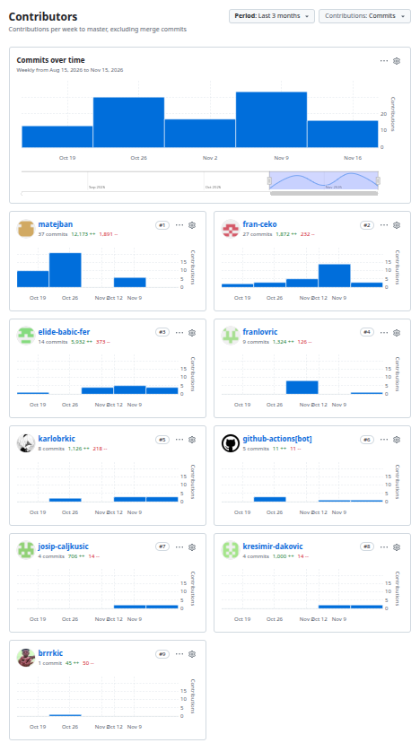

# A. Pregled aktivnosti grupe

**Cilj:** Prikazati kako je tim organizirao projekt, raspodijelio rad, reagirao na važne probleme i pridonio rezultatu. Zapisi trebaju opisivati ishode, a ne samo navoditi da je sastanak održan ili da se o nekoj temi raspravljalo.

## A.1 Evidencija sastanaka

**Cilj:** Voditi kratak zapis projektnih sastanaka i tjedne koordinacije: tko je sudjelovao, što je odlučeno i koja je radnja uslijedila. Raspravu koja nije dovela do odluke zabilježite samo ako je važno pitanje ostalo otvoreno.

**Kratice članova tima:** MB = Matej Ban; FL = Fran Lovrić; KD = Krešimir Daković; KB = Karlo Brkić; EB = Elide Babić; JČ = Josip Čaljkušić; FČ = Fran Čeko.

| Datum i sudionici | Glavna tema | Donesena odluka ili zadatak  | Poveznica na zadatak ili  rezultat, ako postoji |
| --- | --- | --- | --- |
| 12. 10. 2026.; MB, KB, EB, JČ, FČ | Upoznavanje tima, odabir teme i tehnologija | Tim je odabrao vlastitu temu, platformu studentskih popusta UniDeal, i dogovorio tehnologije (Next.js, Supabase, Vercel). Na sastanku je započet opis ideje; MB i EB su ga dovršili i poslali asistentici na pregled. | [1. Opseg projekta](1-Projekt.md) |
| 26. 10. 2026.; MB, FL, KD, KB, EB, JČ, FČ | Podjela rada po područjima | Svaki član radi kao fullstack i preuzima jedno područje: MB temelje, bazu i prijavu; FL partnere i obavijesti; KD ponude i statistiku; KB pretragu, kartu i favorite; EB kupone, QR i recenzije; JČ plaćanje i pretplate; FČ administraciju i izvještaje. Tim je zajedno napravio plan rada po područjima, a MB je kao vlasnik repozitorija otvorio issue za svaku funkcionalnost. | [GitHub Issues](https://github.com/matejban/UniDeal/issues), s oznakom područja (npr. `podrucje-3-ponude`) |
| 11. 11. 2026. (online poziv); MB, FL, KD, KB, EB, JČ, FČ | Provjera napretka po područjima | Svaki član je javio dokle je stigao sa svojim zadacima; tim je provjerio ide li rad prema planu i međusobno se posavjetovao oko otvorenih problema. | [GitHub Issues](https://github.com/matejban/UniDeal/issues) |
| 16. 11. 2026.; MB, FL, KD, KB, EB, JČ, FČ | Stanje koda i plan do predaje | Pregledano je dokle je tko stigao s kodom. Dogovoreno je da se do predaje ne otvaraju novi zadaci i da je fokus dovršetak dokumentacije. | [Dokumentacija](Home.md) |

## A.2 Plan rada

**Cilj:** Prikazati planirani redoslijed rada i odgovornosti u timu. Prikažite projektne tjedne ili druga kratka razdoblja koja tim koristi, uključujući pripremu za formalne provjere.

**Trenutačni plan:** [GitHub Issues](https://github.com/matejban/UniDeal/issues) s oznakama po područjima (`podrucje-1-temelji` … `podrucje-7-admin`, `zajednicko`) i tablica u nastavku. Rad je podijeljen po područjima, a ne po tjednima: svaki član radi na svom području kad mu odgovara, jer su issuei većinom međusobno neovisni. Svatko održava ažurnima issuee svog područja, a MB kao vlasnik repozitorija otvara issuee i održava oznake.

| Razdoblje | Glavni planirani rad | Odgovorni članovi | Poveznica na zadatke |
| --- | --- | --- | --- |
| 18.–25. 10. 2026. | Postavljanje repozitorija, opis projekta i analiza zahtjeva | svi | — |
| 26. 10. – 1. 11. 2026. | Temelji: Supabase projekt, shema i migracije, RLS po ulogama, prijava i uloge, repozitoriji podataka, CI. Podjela zadataka po područjima. | MB (temelji), svi (podjela zadataka) | [#1]–[#8], [#45] |
| od 2. 11. 2026. (paralelno) | Partneri: registracija, javni profil, upload slika, e-mail obavijesti, pretplata studenata | FL | [#10]–[#15] |
| od 2. 11. 2026. (paralelno) | Ponude: CRUD, statusi, automatski istek, kategorije, pregled vlastitih ponuda partnera, statistika za partnera | KD | [#16]–[#20], [#43] |
| od 2. 11. 2026. (paralelno) | Pretraga i karta: filtri, sortiranje, karta, geokodiranje, ponude u blizini, favoriti | KB | [#21]–[#26] |
| od 2. 11. 2026. (paralelno) | Kuponi: generiranje koda i QR koda, ograničenje korištenja, potvrda kod partnera, povijest kupona, recenzije | EB | [#27]–[#31] |
| od 2. 11. 2026. (paralelno) | Plaćanje: Stripe proizvodi i Checkout, webhook, skrivanje ponuda bez pretplate, stranica pretplate | JČ | [#32]–[#36] |
| od 2. 11. 2026. (paralelno) | Administracija: korisnici, odobravanje partnera, kategorije, moderacija, cijene pretplate, statistika za administratora, izvoz CSV/PDF | FČ | [#37]–[#42], [#44] |
| 11.–20. 11. 2026. | Priprema za prvu predaju (20. 11. 2026.): dokumentacija, granice projekta, ručno ispitivanje prijave, ažuriranje README-a | EB ([#48], [#86]), KB ([#49], [#84]), FL ([#46], [#85]), JČ ([#50]), KD ([#51]), FČ ([#47], [#87]), MB ([#9]) | oznaka [`zajednicko`][oznaka-zajednicko] |
| od 21. 11. 2026. | Nastavak rada na zadacima koji nisu riješeni do prve predaje, dovršetak otvorenih zadataka u svakom području i integracija područja (pretplata ↔ vidljivost ponuda, kuponi ↔ recenzije, statistika) | svi, svatko za svoje područje | otvoreni zadaci po oznaci područja |

[#1]: https://github.com/matejban/UniDeal/issues/1
[#8]: https://github.com/matejban/UniDeal/issues/8
[#9]: https://github.com/matejban/UniDeal/issues/9
[#10]: https://github.com/matejban/UniDeal/issues/10
[#15]: https://github.com/matejban/UniDeal/issues/15
[#16]: https://github.com/matejban/UniDeal/issues/16
[#20]: https://github.com/matejban/UniDeal/issues/20
[#21]: https://github.com/matejban/UniDeal/issues/21
[#26]: https://github.com/matejban/UniDeal/issues/26
[#27]: https://github.com/matejban/UniDeal/issues/27
[#31]: https://github.com/matejban/UniDeal/issues/31
[#32]: https://github.com/matejban/UniDeal/issues/32
[#36]: https://github.com/matejban/UniDeal/issues/36
[#37]: https://github.com/matejban/UniDeal/issues/37
[#42]: https://github.com/matejban/UniDeal/issues/42
[#43]: https://github.com/matejban/UniDeal/issues/43
[#44]: https://github.com/matejban/UniDeal/issues/44
[#45]: https://github.com/matejban/UniDeal/issues/45
[#46]: https://github.com/matejban/UniDeal/issues/46
[#47]: https://github.com/matejban/UniDeal/issues/47
[#48]: https://github.com/matejban/UniDeal/issues/48
[#49]: https://github.com/matejban/UniDeal/issues/49
[#50]: https://github.com/matejban/UniDeal/issues/50
[#51]: https://github.com/matejban/UniDeal/issues/51
[#84]: https://github.com/matejban/UniDeal/issues/84
[#85]: https://github.com/matejban/UniDeal/issues/85
[#86]: https://github.com/matejban/UniDeal/issues/86
[#87]: https://github.com/matejban/UniDeal/issues/87
[oznaka-zajednicko]: https://github.com/matejban/UniDeal/issues?q=label%3Azajednicko

## A.3 Aktivnosti i doprinosi članova

**Cilj:** Prikazati koji su članovi radili na važnim projektnim aktivnostima i približan trud koji prijavljuju. Uz implementaciju uključite oblikovanje, dokumentaciju, integraciju, ispitivanje i postavljanje.

| Aktivnost ili rezultat | Član | Prijavljeni sati | Reprezentativni rezultat ili poveznica |
| --- | --- | --- | --- |
| Otvaranje repozitorija | FČ | 1 | Početni commit repozitorija |
| Struktura projekta prema predlošku kolegija | EB |  | Direktoriji `docs/`, `tests/`, `db/`, `build/` |
| Odjeljak 1.4 Postojeći pristupi | FČ | 2 | `docs/1-Projekt.md` |
| Opis projekta, osnovna Next.js aplikacija, objektno orijentirana struktura i prijava Google računom | MB |  | `README.md`, `src/` |
| Analiza zahtjeva | KB | 2 | `docs/2-Analiza-zahtjeva.md` |
| Supabase projekt, prijava studenata Microsoft računom, prijava partnera e-mailom i profili s ulogom | MB |  | Zadaci [#1] i [#6] |
| Članovi tima u README-u i dorada analize zahtjeva | KB | 1,5 | Zadatak [#45] |
| Upravljanje korisničkim računima i deaktivacija | FČ | 8 | Zadatak [#38], PR [#56] |
| Shema baze i migracije, RLS po ulogama, Supabase repozitoriji, zaštita ruta po ulozi, uređivanje profila, CI i README | MB |  | Zadaci [#2]–[#5], [#7]–[#9] |
| Registracija partnera s provjerom OIB-a | FL | 6 | Zadatak [#10], PR [#69] |
| Generiranje kupona s jedinstvenim kodom i QR kodom | EB |  | Zadatak [#27] |
| Odobravanje partnera u administraciji | FČ | 6 | Zadatak [#37], PR [#68] |
| Javni profil partnera i uređivanje profila | FL | 2,5 | Zadatak [#11], PR [#70] |
| Upload logotipa partnera u Supabase Storage | FL | 3,5 | Zadatak [#13], PR [#71] |
| E-mail obavijesti preko Resenda i predlošci e-mailova Supabase Autha na hrvatskom | FL | 3 | Zadatak [#14], PR [#72] |
| Ograničenje korištenja kupona (jednom po studentu) | EB |  | Zadatak [#29] |
| Stripe klijent i cijene mjesečne i godišnje pretplate | JČ | 3 | Zadatak [#32] |
| Dokumentacija i testovi temelja i autentifikacije | MB |  | UC-1.1 – UC-1.4, CT-1.x, ST-1.x |
| Obrasci uporabe, sljedivost i ispitivanje kupona | EB |  | Zadatak [#48]; UC-5.1 – UC-5.4, CT-5.1, CT-5.2, ST-5.1 – ST-5.4 |
| Upravljanje kategorijama ponuda | FČ | 7 | Zadatak [#39], PR [#78] |
| Statistika za administratora (u tijeku) | FČ | 7 | Zadatak [#42], PR [#79] (prikaz statistike bez prihoda od pretplata; prihod čeka #34) |
| Izrada, uređivanje i brisanje ponude te dijagram razreda (4.3.2) | KD | 15 | Zadatak [#16] |
| Sljedivost F-016 i opis načina rada u README-u | MB |  | `README.md`, `docs/2-Analiza-zahtjeva.md` |
| Stripe Checkout za partnera | JČ | 8 | Zadatak [#33] |
| Brisanje stare slike iz Storagea, ispravak RLS testa, ispitivanje CT-1.3 i ST-1.3 – ST-1.6, dorada obrazaca | MB |  | `docs/5-Ispitivanje.md` |
| Google Maps karta s oznakama partnera | KB | 4 | Zadatak [#23], PR [#91] |
| Geokodiranje adrese partnera i ručno označavanje lokacije | KB | 3,5 | Zadatak [#24], PR [#92] |
| Granice projekta (1.3) i dorada postojećih pristupa (1.4) | FČ | 1,5 | Zadatak [#47] |
| Ručno ispitivanje prijave Microsoft računom | FČ | 1,5 | Zadatak [#87]; ST-1.1, ST-1.2 |
| Obrasci uporabe administratorskog područja | FČ | 7 | UC-7.1 – UC-7.4; PR [#93] |
| Pregled aktivnosti grupe: A.1 Evidencija sastanaka, A.2 Plan rada i A.3 Aktivnosti i doprinosi članova | FČ | 3 | `docs/A-Pregled-aktivnosti-grupe.md`; PR [#96] |
| Ispitni slučajevi s ručnim ispitivanjem na produkciji, sljedivost zahtjeva F-025 – F-031, 6.3, 7.2 i A.5 | FČ | 6 | CT-7.1 – CT-7.4, ST-7.1 – ST-7.5; PR [#103] |
| Dijagram razreda za kupone: `Coupon`, `CouponService` i `CouponRepository` | EB |  | PR [#95]; `docs/puml/4-3-unideal-domain-CD.puml` |
| Obrasci uporabe područja 4 (pretraga, karta i favoriti) | KB | 1 | Zadatak [#48], PR [#100]; UC-4.1 – UC-4.4 |
| Sljedivost i ispitivanje područja 4 | KB | 2 | PR [#100]; CT-4.1 – CT-4.4, ST-4.1 – ST-4.9 |
| Ključne arhitekturne odluke (4.1) | KB | 1,5 | Zadatak [#84], PR [#109] |
| Izjava o uporabi umjetne inteligencije za područje 4 i sati u A.3 | KB | 1 | Zadatak [#51] |
| Dokumentacija pretplate: obrasci uporabe, sljedivost i ispitivanje | JČ | 3 | PR [#94]; UC-6.1, UC-6.2, CT-6.1 – CT-6.3, ST-6.1 – ST-6.4 |
| Ručno ispitivanje pretplate i upis rezultata | JČ | 2 | PR [#101]; ST-6.1 – ST-6.4 |
| Evidencija sastanaka (A.1), pregled promjena u repozitoriju (A.4) i izjava o uporabi umjetne inteligencije za područje 6 | JČ | 2 | Zadatak [#50], PR [#104] |
| Obrasci uporabe i sljedivost područja partnera | FL | 1,5 | PR [#99]; UC-2.1 – UC-2.4 |
| Ispitni slučajevi područja partnera | FL | 1 | PR [#106]; CT-2.1 – CT-2.3, ST-2.1 – ST-2.6 |

[#2]: https://github.com/matejban/UniDeal/issues/2
[#5]: https://github.com/matejban/UniDeal/issues/5
[#6]: https://github.com/matejban/UniDeal/issues/6
[#7]: https://github.com/matejban/UniDeal/issues/7
[#11]: https://github.com/matejban/UniDeal/issues/11
[#13]: https://github.com/matejban/UniDeal/issues/13
[#14]: https://github.com/matejban/UniDeal/issues/14
[#23]: https://github.com/matejban/UniDeal/issues/23
[#24]: https://github.com/matejban/UniDeal/issues/24
[#29]: https://github.com/matejban/UniDeal/issues/29
[#33]: https://github.com/matejban/UniDeal/issues/33
[#38]: https://github.com/matejban/UniDeal/issues/38
[#39]: https://github.com/matejban/UniDeal/issues/39
[#56]: https://github.com/matejban/UniDeal/pull/56
[#68]: https://github.com/matejban/UniDeal/pull/68
[#78]: https://github.com/matejban/UniDeal/pull/78
[#79]: https://github.com/matejban/UniDeal/pull/79
[#94]: https://github.com/matejban/UniDeal/pull/94
[#95]: https://github.com/matejban/UniDeal/pull/95
[#91]: https://github.com/matejban/UniDeal/pull/91
[#92]: https://github.com/matejban/UniDeal/pull/92
[#100]: https://github.com/matejban/UniDeal/pull/100
[#109]: https://github.com/matejban/UniDeal/pull/109
[#101]: https://github.com/matejban/UniDeal/pull/101
[#104]: https://github.com/matejban/UniDeal/pull/104
[#103]: https://github.com/matejban/UniDeal/pull/103
[#93]: https://github.com/matejban/UniDeal/pull/93
[#96]: https://github.com/matejban/UniDeal/pull/96
[#69]: https://github.com/matejban/UniDeal/pull/69
[#70]: https://github.com/matejban/UniDeal/pull/70
[#71]: https://github.com/matejban/UniDeal/pull/71
[#72]: https://github.com/matejban/UniDeal/pull/72
[#99]: https://github.com/matejban/UniDeal/pull/99
[#106]: https://github.com/matejban/UniDeal/pull/106

## A.4 Pregled promjena u repozitoriju

**Cilj:** Prikazati kada su promjene napravljene u repozitoriju i tko ih je napravio, uz napomenu da sam broj zapisa promjena ne mjeri kvalitetu doprinosa.

**Prikaz aktivnosti repozitorija:** GitHubov prikaz [Contributors](https://github.com/matejban/UniDeal/graphs/contributors), snimljen 19. 11. 2026. Prikazuje tjedni broj commitova u granu `master` bez merge commitova, od početka rada u listopadu do tjedna 16. 11. 2026. (na GitHubu razdoblje „Last 3 months”; prije listopada nema aktivnosti).

Graf broji samo commitove, pa ne prikazuje pregled i spajanje pull requestova (MB pregledava i spaja PR-ove, a merge commitovi se ne broje), sastanke ni ručno ispitivanje. Broj commitova ovisi i o načinu rada: neki članovi zadatak predaju jednim commitom, a drugi s više manjih, pa iz grafa nije moguće izvesti uloženi trud. `github-actions[bot]` je automatski posao koji iz PlantUML izvora ponovno iscrtava dijagrame, a `brrrkic` je drugi GitHub račun Karla Brkića (KB) s kojim je 27. 10. predan jedan commit analize zahtjeva.

## A.5 Ključni inženjerski izazovi i rješenja

**Cilj:** Dokumentirati stvarne tehničke i organizacijske prepreke s kojima se tim suočio, poduzete korektivne inženjerske korake te konačni ishod. Odaberite konkretne izazove umjesto općenite pohvale timskog rada.

| Izazov | Poduzeta radnja | Ishod ili preostalo ograničenje |
| --- | --- | --- |
| Status studenta trebalo je potvrditi bez ručne provjere dokumenata, a domena e-mail adrese ne razlikuje studenta od djelatnika iste ustanove (AS-01). | MB je uveo prijavu studenata studentskim Microsoft računom; SQL funkcija `student_institution` dodjeljuje status studenta prema popisu domena hrvatskih visokih učilišta. MB i EB dodali su uvjete korištenja (F-032) s obvezom pokazivanja X-ice pri korištenju kupona, a prijava putem AAI@EduHr zapisana je kao budući rad (7.3). | Student FER-a dobiva potvrđen status pri prvoj prijavi (ST-1.1). Ostaje ograničenje: djelatnik može dobiti status studenta, popis domena održava se ručno, a stvarnim računom provjerena je samo domena `fer.hr` (5.4). |
| Nakon zamjene loga partnera ili fotografije ponude stara datoteka ostajala je u Supabase Storageu, a brisanje nije javljalo grešku. | MB je utvrdio da Storage za brisanje treba i pravilo za `select` nad `storage.objects`. Dodao je to pravilo (vlasnik vidi samo datoteke u mapi svojeg partnera) i funkciju `deleteImage()`, koja briše staru sliku pri zamjeni i pri brisanju ponude ([#81]). | Nakon zamjene u Storageu ostaje samo nova datoteka. Neuspjelo brisanje samo se zapisuje u log, a partnerova radnja svejedno uspijeva, pa datoteka u tom slučaju i dalje može ostati. |
| Stripe ključ nije radio na starijoj preview inačici aplikacije, iako je bio upisan u Vercel. | Uočeno je da je pri slanju ključa preko Outlooka (JČ je ključ iz Stripea poslao MB-u, koji ga je upisao u Vercel) prvo slovo ključa automatski postalo veliko. Ključ je ponovno upisan u Vercel u izvornom obliku. | Plaćanje preko Stripea je proradilo, jer je promijenjeno slovo bilo jedina greška. |

[#81]: https://github.com/matejban/UniDeal/pull/81

---

>**Završna provjera:** Sastanci navode smislene ishode i odgovorne osobe; plan odražava namjeravani rad; tablica uloženog rada i generirani prikaz repozitorija odnose na ovaj vidljivi projekt; konkretni izazovi povezani su s radnjama i njihovim rezultatima. 